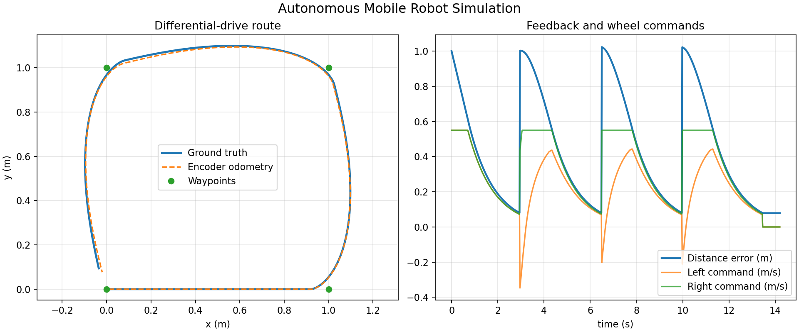

# Autonomous Mobile Robot Simulation

This project is a personal validation simulation of a differential-drive
mobile robot. It extends a basic kinematics exercise into a reproducible
feedback loop:

~~~text
waypoints -> waypoint controller -> wheel commands
                         |
                         v
              differential-drive model
                         |
                         v
          quantized wheel encoder odometry
                         |
                         +----> controller feedback
~~~

The simulation records both ground-truth motion and an odometry estimate. The
controller uses the odometry pose, not the hidden ground-truth pose, to select
wheel speeds for a rectangular waypoint route.

This repository demonstrates kinematics, feedback control, encoder
quantization, Python software structure, CSV logging, automated tests, and
result visualization. It also contains a separate ROS 2 Jazzy and Gazebo Sim
integration that drives a modeled robot with odometry and a laser scanner.
It does not claim physical robot, encoder hardware, or competition validation.

## Run the simulation

~~~bash
python3 -m venv .venv
source .venv/bin/activate
python3 -m pip install -r requirements.txt

python3 simulate.py --output results/trajectory.csv
python3 scripts/plot_trajectory.py \
  results/trajectory.csv media/trajectory-and-odometry.png
~~~

The main output is results/trajectory.csv. The generated plot compares
ground-truth motion with quantized encoder odometry and shows tracking error
and wheel commands.

## Test

~~~bash
python3 -m pytest
~~~

The test suite covers straight motion, in-place rotation, wheel-speed
limiting, encoder quantization, waypoint controller behavior, route
completion, and the difference between ground truth and odometry.

## Model and assumptions

- Differential-drive wheel base: 0.30 m.
- Maximum wheel speed: 0.80 m/s.
- Encoder model: 2048 ticks/revolution, wheel radius 0.05 m.
- Controller: proportional waypoint feedback with linear and angular limits.
- Route: (1,0) -> (1,1) -> (0,1) -> (0,0) m.
- Time step: 0.02 s.

The robot model is intentionally small and explainable. It does not model
slip, motor dynamics, battery voltage, sensor noise, obstacles, or a physical
encoder circuit.

## ROS 2 and Gazebo Sim

The ROS 2 package is in ros2_ws/src/mobile_robot_gazebo. It launches a custom
differential-drive SDF model in Gazebo Sim 8, bridges Gazebo topics into ROS 2,
and runs a waypoint controller that subscribes to /odom and /scan before
publishing /cmd_vel.

Requirements: ROS 2 Jazzy, Gazebo Sim 8, ros_gz_sim, ros_gz_bridge, RViz2,
colcon, and Python rclpy packages.

~~~bash
source /opt/ros/jazzy/setup.bash
cd ros2_ws
colcon build --packages-select mobile_robot_gazebo
source install/setup.bash
ros2 launch mobile_robot_gazebo gazebo.launch.py
~~~

For a server-only run without the Gazebo GUI:

~~~bash
ros2 launch mobile_robot_gazebo gazebo.launch.py \
  use_rviz:=false \
  gz_args:="$(ros2 pkg prefix mobile_robot_gazebo)/share/mobile_robot_gazebo/worlds/mobile_robot_world.sdf -r -s"
~~~

Useful checks in another terminal:

~~~bash
source /opt/ros/jazzy/setup.bash
source ros2_ws/install/setup.bash
ros2 topic list
ros2 topic echo /odom --once
ros2 topic echo /scan --once
ros2 topic echo /cmd_vel --once
~~~

The route is a square around a central obstacle. The controller uses odometry
for waypoint feedback and monitors the laser scan for a simple close-obstacle
stop-and-turn behavior. The ROS 2 and Gazebo result is documented in
docs/GAZEBO_RESULTS.md.

## Portfolio evidence

- Source code: mobile_robot_sim/.
- Reproducible CSV: results/trajectory.csv.
- Generated analysis plot: media/trajectory-and-odometry.png.
- Automated checks: tests/.
- Continuous integration: .github/workflows/ci.yml.

The project is a personal validation implementation. It should be described
as simulation work in a CV or interview unless physical test evidence is
added later.
